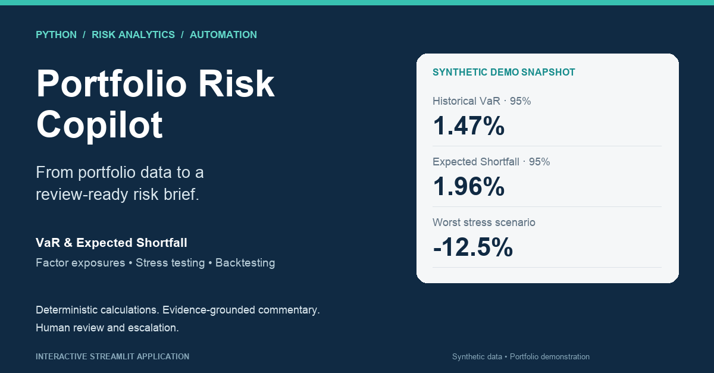
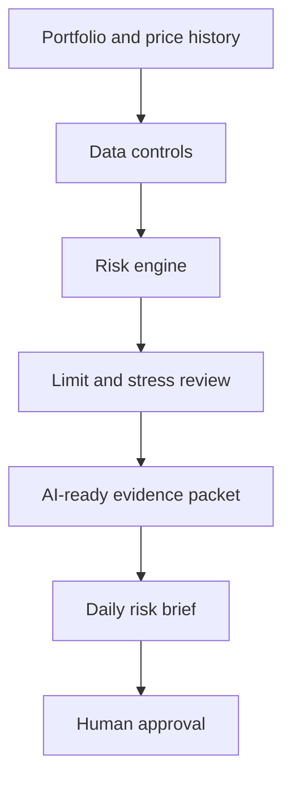

# Portfolio Risk Copilot

[Launch the public demo](https://emma-portfolio-risk-copilot.streamlit.app/) · [LinkedIn Featured assets](LINKEDIN_FEATURED.md)



An auditable multi-asset risk workflow built for portfolio-risk, market-risk, treasury, and quantitative-finance interviews.

The project separates three responsibilities:

1. **Risk calculation** — deterministic Python calculations own returns, volatility, VaR, Expected Shortfall, factor exposure, drawdown, risk contribution, and scenario loss.
2. **Risk interpretation** — a review agent converts validated metrics into ranked findings with explicit evidence references.
3. **Communication and approval** — a communication agent drafts a daily risk brief; the analyst remains responsible for approval and escalation.

No language model can change positions, prices, calculated metrics, limits, or pass/fail results.

## Decision question

Where is the portfolio's risk concentrated, how does it behave under equity, rates, credit, and FX shocks, and which changes require escalation?

## V2 workflow



## Outputs

- `risk_metrics.json` — canonical calculated metrics.
- `risk_review_packet.json` — restricted, evidence-linked packet for AI commentary.
- `risk_brief.html` — reviewer-facing daily risk brief.
- `risk_dashboard.png` — compact portfolio-risk visualization.
- `var_backtest.png` — rolling VaR threshold, realized return, and exception chart.
- `approved_risk_brief.html` — created only after explicit analyst approval.

## Interactive review workspace

The Streamlit application turns the analysis into a reviewer-facing workflow rather than a static portfolio page. A reviewer can switch between the bundled demonstration portfolio and uploaded CSV inputs, then inspect decision findings, position risk, factor sensitivities, stress losses, VaR exceptions, and control evidence.

```bash
pip install -r requirements.txt
streamlit run app.py
```

The five tabs deliberately mirror a practical review sequence:

1. **Decision brief** — ranked exceptions and required analyst actions.
2. **Exposure map** — portfolio weight, volatility contribution, beta, and proxy-factor sensitivity.
3. **Stress testing** — scenario returns and estimated dollar P&L.
4. **Model monitoring** — rolling 95% historical VaR backtest and exception log.
5. **Controls & governance** — data-quality evidence, AI boundaries, and report export.

## Run the demo

```bash
python3 generate_demo_data.py
python3 run_demo.py
python3 -m unittest -v
```

The bundled demo data are deterministic and synthetic. This keeps the project reproducible and avoids presenting stale market data as live. The input contract accepts replacement CSVs with the same schema.

## Optional LLM narration

The default demo uses an evidence-grounded deterministic narrator. An optional OpenAI-compatible narrator is available only when both variables are explicitly set:

```bash
export RISK_COPILOT_USE_LLM=1
export OPENAI_API_KEY=...
```

Only the restricted review packet is sent. The calculation engine and control results remain local and deterministic.

## Input contract

### `portfolio.csv`

| Column | Meaning |
| --- | --- |
| `ticker` | Position identifier |
| `asset_class` | Equity, Rates, Credit, Commodity, or FX |
| `quantity` | Units held |
| `price` | Current price |
| `currency` | Position currency |
| `limit_weight` | Maximum absolute portfolio weight |

### `market_prices.csv`

One row per date with `date` plus one adjusted-price column per ticker.

### `stress_scenarios.csv`

One row per scenario and asset class with a decimal return shock.

## Scope boundary

This is a portfolio project, not a production risk system. V2 adds an out-of-sample historical VaR backtest and transparent proxy-factor regression, but it does not model derivatives, nonlinear Greeks, liquidity horizons, counterparty exposure, or regulatory capital. Synthetic demo data must not be represented as live market data.
